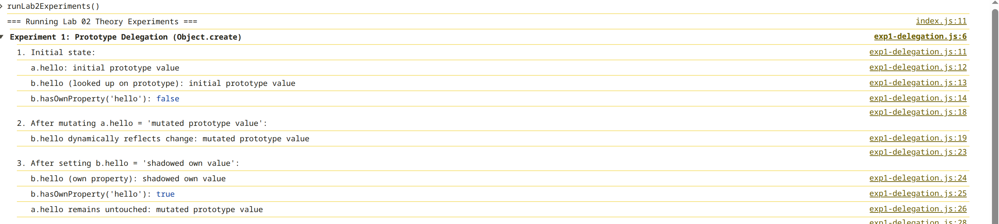
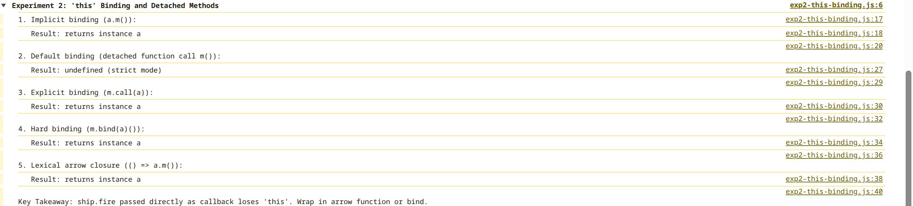
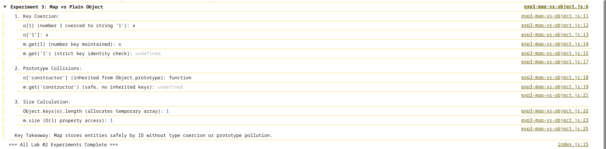

# Lab 02 — Objects, Prototypes, and `this`: The Entity Model

> "JavaScript doesn't have classes. It has objects that delegate to other objects, and a `class` keyword that politely pretends otherwise."

---

## 1. Architecture Overview & Entity Model

```
Game Loop (60 Hz)
  └── World.step(dt, inputs, width, height)
        │
        ├── 1. [SIMULATION PHASE: Movement & Steering]
        │     └── for (const entity of #entities.values())
        │           ├── entity.update(dt, inputs)
        │           │     ├── Ship: steering, thrust, drag damping, speed clamping
        │           │     ├── Bullet: linear translation, ttl countdown, (optional: homing component)
        │           │     ├── Asteroid: linear drift, tumbling spin, (optional: homing component)
        │           │     ├── Pickup: pulse phase update
        │           │     └── Particle: velocity integration, fade-out
        │           └── wrapArena(entity, width, height)   <-- Toroidal border wrap
        │
        ├── 2. [COLLISION SYSTEM: Decoupled Pair Emission]
        │     └── for (const [a, b] of findCollisions(world))  <-- O(n²) circle-circle tests
        │           ├── Bullet <-> Asteroid : Damage / Destroy / Score / Drop Pickup
        │           ├── Bullet <-> Ship     : Shield absorption / HP damage / Respawn trigger
        │           ├── Ship <-> Asteroid   : Crash damage / Shield absorption
        │           └── Ship <-> Pickup     : Apply shield or HP restore / Collect bonus
        │
        ├── 3. [LIFECYCLE & RESPAWN]
        │     └── if (!ship.alive) -> 2s countdown -> Safe arena spawn calculation -> ship.heal()
        │
        └── 4. [DEFERRED SWEEP PHASE]
              └── for (const [id, entity] of #entities)
                    └── if (!entity.alive && entity.kind !== "ship") -> #entities.delete(id)
```

### Module Responsibilities

- **`src/physics/vector.js`**: Immutable 2D vector mathematics (`Vector2`). Methods (`add`, `sub`, `scale`, `normalize`, `rotate`, `dot`) return brand-new instances (`Object.freeze(this)`), preventing accidental in-place mutation bugs.
- **`src/physics/entities/entity.js`**: Base class for all simulation objects. Manages private identity (`#id = crypto.randomUUID()`), spatial position vectors (`pos`, `vel`), orientation angle, collision radius, and base linear integration (`update(dt)`).
- **`src/physics/entities/ship.js`**: Player aircraft (`Ship extends Entity`). Single-level inheritance with private `#hp = 100`, private `#shield = 0`, Newtonian thrust physics, and projectile firing (`fire()`).
- **`src/physics/entities/bullet.js`**: High-speed projectile (`Bullet extends Entity`). Carries inherited shooter velocity, damage value, and time-to-live (`ttl`). Supports pluggable homing steering.
- **`src/physics/entities/asteroid.js`**: Drifting obstacle (`Asteroid extends Entity`). Random drift velocity, tumbling spin, destructible health pool, and optional homing tracking.
- **`src/physics/entities/pickup.js`**: Stationary bonus item (`Pickup extends Entity`). Grants defensive energy shields (`+50 Shield`) or field repairs (`+35 HP`).
- **`src/physics/entities/explosion.js`**: Particle entity (`Particle extends Entity`) and radial burst spawner (`spawnExplosion`). Demonstrates lifecycle of high-frequency short-lived objects.
- **`src/physics/homing.js`**: Reusable steering behavior component (`HomingBehavior`). Can be attached via composition to any entity.
- **`src/physics/world.js`**: Entity store backed by `Map<string, Entity>`. Implements `[Symbol.iterator]()`, generator filter `*ofKind(kind)`, and deferred dead-entity sweeping.
- **`src/physics/collision.js`**: Decoupled circle-circle intersection testing (`distSq <= radSumSq`). Emits colliding `[a, b]` pairs independently of the storage structure.

---

## 2. The `this` Bug & Call-Site Binding

### The Problem: Detached Methods Lose Context

In JavaScript, `this` is not statically bound to the class where the function was declared. It is resolved dynamically at the **call site** based entirely on *how* the function is invoked.

When connecting ship firing to an event or detached callback:

```javascript
// BUG: Detaching method from object
const shootCallback = ship.fire;
shootCallback(); // TypeError: Cannot read properties of undefined (reading 'pos')
```

### The Four Rules of `this` (Precedence Order)

1. **`new` Binding**:
   - `new Ship(...)`
   - `this` is bound to the newly constructed object created by the JavaScript engine.
2. **Explicit Binding**:
   - `fn.call(ship)`, `fn.apply(ship)`, or `fn.bind(ship)`
   - `this` is explicitly specified as the first argument. `.bind()` returns an exotic bound function with its `this` permanently fixed.
3. **Implicit Binding**:
   - `ship.fire()`
   - `this` is bound to the contextual object to the immediate left of the dot (`ship`) at the call site.
4. **Default Binding**:
   - Plain function invocation: `shootCallback()`
   - In ES modules and strict mode (`"use strict"`), `this` defaults to **`undefined`**.
   - In non-strict (sloppy) mode, `this` defaults to `globalThis` (`window` in browsers).

Because classes and ES modules always execute in strict mode, calling `shootCallback()` triggers **Rule 4 (Default Binding)**, setting `this` to `undefined`. Attempting to read `this.pos` immediately crashes with a `TypeError`.

### The Three Solutions & Trade-off Analysis

| Technique | Implementation | How It Fixes `this` | Memory & Performance Trade-off |
| :--- | :--- | :--- | :--- |
| **1. Arrow Function Wrapper (Chosen)** | `() => ship.fire()` | Arrow functions have **no `this` of their own**. They capture `this` lexically from the enclosing scope. At call site, `ship.fire()` uses standard dot notation (Implicit Binding). | **Optimal for shared prototype methods**. `fire` stays on `Ship.prototype` and is shared by all instances. Allocates one lightweight closure wrapper at the event site. |
| **2. Explicit `.bind()`** | `ship.fire.bind(ship)` | Returns a permanently bound copy of the function with internal `[[BoundThis]]` set to `ship`. | Creates an additional bound function object in memory. Less readable when chaining or passing inline handlers. |
| **3. Class Field Arrow Method** | `fire = () => { ... }` in class body | Property is assigned inside constructor as an own instance property. | **Worst memory efficiency for high entity counts**. Function is duplicated on *every single instance* (`ship1.fire !== ship2.fire`), preventing prototype method sharing. |

---

## 3. Browser Console Experiments & Proofs

Before building complex game systems, three fundamental JavaScript mechanics were proven in the browser console.

### Experiment 1: Prototype Delegation vs Property Copying (`Object.create`)

#### Why We Test This

In our game, we spawn hundreds of bullets, particles, and asteroids. If each instance copied its own `update()` and `draw()` methods into memory, heap consumption would explode and trigger severe Garbage Collection pauses at 60 Hz. We test `Object.create` to prove that JavaScript classes use **dynamic prototype lookup** rather than property copying, sharing a single method instance across unlimited objects.

#### The Code (`src/expirements/lab2/exp1-delegation.js`)



#### What This Proves

1. `b` does not copy `a.hello`. It delegates lookups along the prototype chain.
2. Modifying the prototype immediately updates all delegate instances in real time.
3. Writing `b.hello` creates an *own property* on `b` (shadowing), leaving the prototype untouched.

---

### Experiment 2: Call-Site `this` Loss and Detached Callbacks

#### Why We Test This

When wiring keyboard listeners or simulation loops (`addEventListener("click", ship.fire)`), passing method references without context is the single most common bug in object-oriented JavaScript. We test detached method invocations to observe strict mode default binding (`undefined`) directly and compare the runtime behavior of the three standard fixes.

#### The Code (`src/expirements/lab2/exp2-this-binding.js`)



#### What This Proves

1. Detaching a method causes the call site to lose its context object.
2. Strict mode (which ES modules enforce) prevents `this` from silently falling back to `window`, yielding `undefined`.
3. Arrow function closures capture `a` lexically, guaranteeing that `a.m()` executes with implicit dot binding at runtime.

---

### Experiment 3: `Map` vs Plain Object (`{}`) for Entity Store

#### Why We Test This

The simulation requires an entity manager (`World`) that frequently adds, queries, and sweeps entities by ID. Beginners often use plain objects (`{}`) as dictionaries. We test `Map` against `{}` to demonstrate why plain objects are unsafe for game entity registries due to type coercion, prototype key collision, and performance overhead.

#### The Code (`src/expirements/lab2/exp3-map-vs-object.js`)



#### What This Proves

1. **Type Safety**: `Map` distinguishes between number and string keys (`m.get(1) !== m.get("1")`). Plain objects stringify all keys.
2. **Zero Collision Risk**: Accessing `o["constructor"]` returns built-in `Object`, which can corrupt entity lookups if an entity ID matches an inherited prototype method. `Map` contains only explicit entries.
3. **Engine Performance**: `m.size` is an instant $O(1)$ read without memory allocation. Checking object size via `Object.keys(o).length` allocates a temporary array every frame, creating avoidable garbage collection pressure.

---

## 4. Composition over Inheritance (Design Justification)

### The Anti-Pattern: Deep Class Hierarchies

The intuitive object-oriented approach often attempts to model game entities through inheritance hierarchies:

```
Entity
  |-- MovingEntity
  |     |-- HomingEntity
  |     |     |-- HomingBullet
  |     |     \-- HomingAsteroid  <-- DUPLICATION: Two separate branches need homing!
  |     \-- Ship
  |           \-- PickupShip?     <-- BREAKS: Pickup is collidable, but NOT a ship!
  \-- StationaryEntity
        \-- Pickup
```

### Why Deep Hierarchies Break in JavaScript

1. **No Multiple Inheritance**: JavaScript only supports single-parent prototype delegation (`class A extends B`). Writing `class HomingBullet extends Bullet, HomingEntity` is an illegal syntax error.
2. **Behavioral Orthogonality**: In games, behaviors are cross-cutting concerns:
   - A bullet moves and can home.
   - An asteroid drifts and can home.
   - A pickup is stationary and collidable, but applies bonuses to ships.
   Trying to fit orthogonal behaviors into an inheritance tree leads to the "Gorilla-Banana" problem: wanting a banana, but getting the gorilla holding the banana and the entire jungle.

### The Solution: The Component Pattern (Composition)

In this project, inheritance is strictly **at most one level deep** (`Ship extends Entity`, `Bullet extends Entity`, `Asteroid extends Entity`, `Pickup extends Entity`). Additional behaviors are attached as **independent components**:

```javascript
// Reusable component:
export class HomingBehavior {
    constructor({ target, turnRate = 40, minDistance = 50 }) { ... }
    update(entity, dt) { ... }
}

// 1. Attached to a Bullet:
bullet.homing = new HomingBehavior({ target: nearestAsteroid, turnRate: 45 });

// 2. Attached to an Asteroid chasing player:
asteroid.homing = new HomingBehavior({ target: playerShip, turnRate: 25 });

// 3. Detached on demand:
bullet.homing = null; // When bullet crosses screen border
```

#### Key Architectural Benefits

- **Zero code duplication**: The exact same steering and angle math steers both bullets and asteroids.
- **Dynamic attach/detach at runtime**: When a bullet crosses the arena boundary, setting `bullet.homing = null` immediately turns off homing while the bullet continues flying along its current momentum vector.
- **Serialization ready (Lab 5 preparation)**: Components can be serialized as plain JSON data blocks (`{ homing: { targetId: "...", turnRate: 45 } }`).

---

## 5. Whiteboard & Defense Preparation Guide

*(Questions for oral exam and whiteboard defense)*

### Q1: State the four rules of `this` in precedence order. What is `this` in `setTimeout(ship.fire, 100)`?

1. `new` binding (`new Ship()`)
2. Explicit binding (`.call()`, `.apply()`, `.bind()`)
3. Implicit binding (`ship.fire()`)
4. Default binding (plain `fn()`, `undefined` in strict mode)

In `setTimeout(ship.fire, 100)`:
`ship.fire` passes a reference to the function itself, stripping the dot context. `setTimeout` invokes the function without dot syntax. In ES module strict mode, **`this` is `undefined`** (in browser window global context in sloppy mode).

- **Fix 1**: `setTimeout(() => ship.fire(), 100)` — captures `ship` lexically. Downside: creates a temporary closure.
- **Fix 2**: `setTimeout(ship.fire.bind(ship), 100)` — permanently bound function. Downside: creates a new function wrapper instance in heap.
- **Fix 3**: Declare `fire = () => {}` as class field. Downside: creates a separate function instance on every ship instance; cannot be shared via `Ship.prototype`.

---

### Q2: Why do arrow functions ignore `.bind`? Where are they the wrong choice?

- **Why ignore `.bind`**: Arrow functions do not possess a `[[BoundThis]]` slot or their own `this` binding at all. They look up `this` in their outer lexical scope chain exactly like a standard variable closure. Calling `fn.bind(...)` on an arrow function has zero effect on `this`.
- **Where they are the wrong choice**: As methods shared by thousands of class instances (e.g., `update = () => {}` on 5,000 bullets). Prototype methods defined as `update(dt) {}` exist **once** in memory on `Bullet.prototype`. Arrow class field methods are recreated on every individual instance, consuming megabytes of unnecessary heap memory.

---

### Q3: Why `Map` over a plain Object (`{}`) for the entity store?

1. **Arbitrary Key Types**: `Map` supports true types (UUID strings, integer IDs, object references) without string coercion.
2. **Built-in `.size`**: `map.size` is an instantaneous $O(1)$ property. Plain objects require allocating an intermediate array via `Object.keys(obj).length` ($O(n)$).
3. **Zero Prototype Collisions**: Plain objects inherit properties from `Object.prototype`. Accessing `obj["constructor"]`, `obj["toString"]`, or `obj["__proto__"]` can return unexpected inherited values or trigger prototype pollution bugs. `Map` only contains explicit keys set via `.set()`.
4. **Performance on High Add/Remove**: Modern V8 engines optimize `Map` hash buckets specifically for frequent insertions and deletions, whereas frequent property deletions on plain objects (`delete obj[id]`) force V8 hidden class deoptimizations.

---

### Q4: Draw the prototype chain for `const s = new Ship()` where `class Ship extends Entity`

```
s (Ship instance: has own properties pos, vel, #hp, #shield)
  |
  +-- [[Prototype]] --> Ship.prototype (has fire, update, heal, addShield)
                          |
                          \-- [[Prototype]] --> Entity.prototype (has base update, getters x, y, vx, vy)
                                                  |
                                                  \-- [[Prototype]] --> Object.prototype (has hasOwnProperty, toString)
                                                                          |
                                                                          \-- [[Prototype]] --> null
```

**Static Inheritance Chain (for constructors)**:
`Ship` (`[[Prototype]]`) -> `Entity` -> `Function.prototype` -> `Object.prototype` -> `null`.

When calling `s.update(dt)`:

1. Engine checks if `s` has own property `update`. No.
2. Looks up prototype: `Ship.prototype.update`. Found. Executes `Ship.prototype.update` with `this = s`.
3. When `Ship.prototype.update` calls `super.update(dt)`, engine looks up prototype of `Ship.prototype` (`Entity.prototype.update`) and executes it with `this = s`.

---

### Q5: What exactly does the `new` keyword do?

Writing `const s = new Ship(args)` executes four exact steps:

1. Allocates a fresh, empty plain JavaScript object: `obj = {}`.
2. Links `obj.__proto__` to `Ship.prototype` (`Object.setPrototypeOf(obj, Ship.prototype)`).
3. Invokes constructor function with `this` explicitly bound to the new object: `Ship.call(obj, ...args)`.
4. Returns `obj` automatically (unless the constructor explicitly returns another non-primitive object).

---

### Q6: Why do people say `class` is "just syntactic sugar"? Name 3 things `class` does that constructor functions don't

`class` is sugar because under the hood it relies on prototype delegation (`Ship.prototype`). However, it introduces language-level guardrails:

1. **Must be called with `new`**: Invoking `Ship()` without `new` throws `TypeError: Class constructor Ship cannot be invoked without 'new'`, whereas constructor functions silently pollute the global scope in non-strict mode.
2. **Methods are non-enumerable**: Methods defined inside a `class` body have `enumerable: false` in their property descriptor, keeping `for...in` and `Object.keys()` clean.
3. **Private fields (`#field`)**: Classes support true hard private fields enforced at the engine syntax level. Constructor functions can only simulate privacy via closures, which cannot be accessed by other instances of the same class.

---

### Q7: What is an iterable? Why could `[...world]` be a problem in a game loop?

- **Iterable**: Any object that implements the `[Symbol.iterator]()` method returning an iterator object with a `.next()` protocol.
- **Why `[...world]` is dangerous at 60 Hz**:
  The spread operator (`[...world]`) exhausts the iterator and allocates a **brand-new array** in memory every single frame. At 60 frames per second, creating temporary arrays causes rapid memory heap churn and triggers frequent **Garbage Collection (GC) pauses**, producing visible frame drops and stutter.
  Using a generator loop (`for (const e of world.ofKind("bullet"))`) iterates values on the fly without allocating intermediate array buffers.
