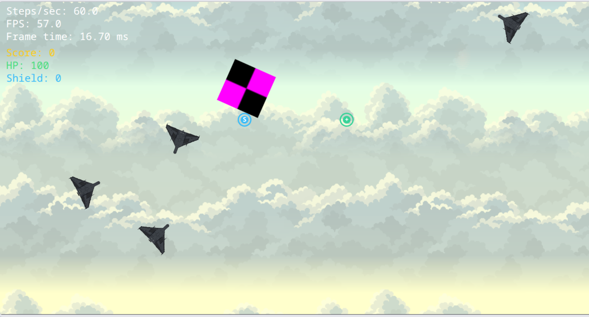
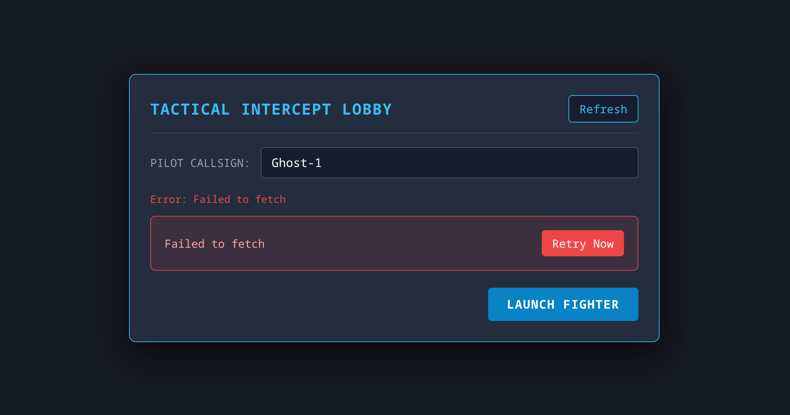
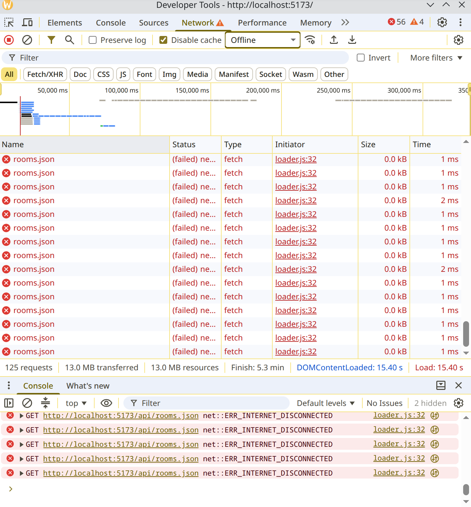
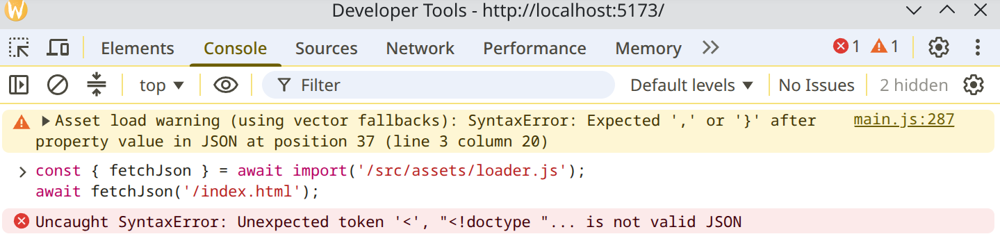

# Lab 03 — Asynchronous JavaScript: Asset Pipeline, Audio, Lobby & Event Bus

> "A promise is a placeholder for a value you don't have yet, plus a contract about how you'll be told."

---

## 1. Architectural Architecture & Async Lifecycle

```text
Application Boot (src/main.js)
  │
  ├── 1. [BOOTSTRAP & ASSET PIPELINE (M1)]
  │     ├── Draw Canvas Loading Screen (indeterminate / 0% -> 100%)
  │     ├── User gesture unlock for AudioContext (src/audio/audio.js)
  │     └── loadAll(manifest, { audioCtx, onProgress, signal })  <-- Promise.all
  │           ├── fetchJson(manifestUrl) (checks response.ok)
  │           ├── withRetry(loadImage) x N (exponential backoff + jitter, bail on 4xx)
  │           ├── withRetry(loadAudio) x M (fetch ArrayBuffer -> decodeAudioData)
  │           └── onProgress(completed / total) -> updates canvas progress bar
  │
  ├── 2. [LOBBY PHASE: HTTP & EventTarget (M3)]
  │     ├── Lobby extends EventTarget (src/ui/lobby.js)
  │     │     ├── fetchRooms() via /api/rooms.json (AbortSignal.timeout(3000))
  │     │     ├── Periodic polling refresh (setInterval)
  │     │     └── Leave lobby / Join room -> controller.abort() (cancels in-flight requests)
  │     └── LobbyView (src/ui/lobby-view.js) listens to lobby events -> renders DOM UI
  │
  ├── 3. [SIMULATION & COMBAT PHASE (M2)]
  │     ├── EventTarget Bus (Zero audio/HUD imports in simulation core)
  │     │     ├── World / Ship / Entities emit CustomEvent:
  │     │     │     ├── "fired"           -> Audio plays laser sound
  │     │     │     ├── "hit"             -> Audio plays impact sound
  │     │     │     ├── "exploded"        -> Audio plays boom; HUD triggers score flash
  │     │     │     └── "scoreChanged"   -> HUD updates counter
  │     │     └── Audio module & HUD module subscribe to Bus independently
  │     ├── Parallax Sky & Cloud Background:
  │     │     ├── Base forward cruise drift (downward +Y)
  │     │     ├── Velocity reaction: Deep (k=0.12), Mid (k=0.28), Near (k=0.55)
  │     │     └── Pre-processed vertical alpha fade (dest-in) to eliminate hard seam lines
  │     └── Render: Animated sprite queues & source rectangles with graceful vector fallback
  │
  └── 4. [FAILURE HANDLING & GRACEFUL DEGRADATION (M4)]
        ├── 404 image -> placeholder checkerboard texture
        ├── Missing audio -> silent stub AudioBuffer (game continues without crash)
        ├── Network timeout -> clear retry button UI
        └── Unhandled rejection prevention (window.addEventListener("unhandledrejection"))
```

### Module Responsibilities

- **`src/assets/loader.js`**: Core asynchronous asset loading pipeline. Provides `fetchJson`, `loadImage`, `loadAudio`, `withRetry` (exponential backoff with jitter, immediate bail on 4xx), and concurrent `loadAll` with live progress accounting.
- **`src/audio/audio.js`**: Web Audio subsystem. Encapsulates `AudioContext`, unlocks on first user interaction gesture (`unlockAudio`), creates zero-latency `AudioBufferSourceNode` voices, and provides decoupled event bus binding (`bindEvents`).
- **`src/ui/lobby.js`**: Tactical room lobby controller (`Lobby extends EventTarget`). Handles polling, `AbortSignal.timeout(3000)`, manual `AbortController` cancellation on room join, and custom event dispatches (`roomsChanged`, `error`, `joined`).
- **`src/ui/lobby-view.js`**: Decoupled DOM overlay. Subscribes strictly to `Lobby` events and renders sector cards, threat ratings, ping indicators, and mission launch trigger.
- **`src/render/background.js`**: Parallax scrolling environment (`ParallaxBackground`). Implements multi-layered cloud depth, velocity-reactive offsets, dynamic day/night theme switching, and seamless vertical alpha fading.
- **`src/physics/world.js`**: Decoupled simulation core (`World extends EventTarget`). Emits gameplay events (`fired`, `hit`, `exploded`, `scoreChanged`) with **zero** imports of audio or HUD components.

---

## 2. Benchmark: Sequential vs Concurrent Loading

Measured with `performance.now()` in `src/expirements/lab3/exp3-parallel-vs-sequential.js` (recorded in `savings.txt`):

```text
Items Loaded: 5 asynchronous assets with simulated network latency (60ms - 110ms)
Theoretical Waterfall Sum: 410 ms
Theoretical Concurrent Max: 110 ms
```

| Strategy | Execution Mechanism | Measured Duration | Latency Profile |
| :--- | :--- | :--- | :--- |
| **Sequential** | `for (const item of items) await load(item)` | **412.62 ms** | $\sum_{i=1}^n T_i$ (Waterfall) |
| **Concurrent** | `await Promise.all(items.map(load))` | **110.46 ms** | $\max(T_i)$ (Parallel batch) |

$$\text{Speedup Multiplier} = \frac{412.62\text{ ms}}{110.46\text{ ms}} = \mathbf{3.74\times\text{ faster}}$$

#### Live Benchmark Run Output
```text
[Exp 3] Parallel vs Sequential Benchmark Results:
┌───────────────────┬────────────────┐
│ (index)           │ Values         │
├───────────────────┼────────────────┤
│ sequentialTimeMs  │ 412.62         │
│ parallelTimeMs    │ 110.46         │
│ speedupMultiplier │ '3.74x faster' │
└───────────────────┴────────────────┘
```

> **Architecture Rule**: Sequential `await` in loops creates an anti-pattern known as an "async waterfall". All independent I/O operations must be grouped into `Promise.all` or `Promise.allSettled`.

---

## 3. Microtask & Macrotask Ordering Puzzles

### Puzzle 1: Microtask Queue vs Macrotask Queue

```javascript
console.log("A");

setTimeout(() => {
    console.log("B");
}, 0);

Promise.resolve()
    .then(() => {
        console.log("C");
    })
    .then(() => {
        console.log("D");
    });

queueMicrotask(() => {
    console.log("E");
});

console.log("F");
```

#### Expected Output
```text
A
F
C
E
D
B
```

#### Step-by-Step Explanation
1. `console.log("A")` runs synchronously $\rightarrow$ prints **A**.
2. `setTimeout(..., 0)` registers a timer with the host. The callback is pushed to the **Macrotask queue**.
3. `Promise.resolve().then(...)` queues its first fulfillment handler onto the **Microtask queue**.
4. `queueMicrotask(...)` queues its callback directly onto the **Microtask queue** behind `C`.
5. `console.log("F")` runs synchronously $\rightarrow$ prints **F**.
6. The synchronous callstack is now completely empty. The engine immediately drains the **Microtask queue**:
   - Executes callback for `C` $\rightarrow$ prints **C**. Returning a value schedules the second chained `.then(D)` onto the microtask queue.
   - Executes callback for `E` $\rightarrow$ prints **E**.
   - Executes callback for `D` $\rightarrow$ prints **D**.
7. Microtask queue is now empty. The event loop picks the oldest task from the **Macrotask queue**:
   - Executes `setTimeout` callback $\rightarrow$ prints **B**.

---

### Puzzle 2: `async/await` Desugaring & Execution Suspension

```javascript
async function first() {
    console.log("1");
    await second();
    console.log("2");
}

async function second() {
    console.log("3");
}

console.log("4");
first();
console.log("5");
```

#### Expected Output
```text
4
1
3
5
2
```

#### Step-by-Step Explanation
1. `console.log("4")` executes synchronously $\rightarrow$ prints **4**.
2. `first()` is called.
3. Inside `first()`: `console.log("1")` runs synchronously $\rightarrow$ prints **1**.
4. `await second()` evaluates `second()` synchronously:
   - Inside `second()`: `console.log("3")` runs synchronously $\rightarrow$ prints **3**.
   - `second()` returns a fulfilled Promise (`Promise.resolve(undefined)`).
5. The `await` keyword pauses execution of `first()`, wraps the evaluated value in a Promise microtask, and yields control back to the caller.
6. Execution resumes in the outer script: `console.log("5")` executes $\rightarrow$ prints **5**.
7. Callstack is empty. The microtask queue resumes `first()` immediately after the `await` expression $\rightarrow$ prints **2**.

---

### Puzzle 3: Macrotask Scheduled Inside Microtask (`setTimeout` inside `.then`)

```javascript
console.log("Start");

Promise.resolve().then(() => {
    console.log("Microtask 1");
    setTimeout(() => {
        console.log("Nested Macrotask");
    }, 0);
    Promise.resolve().then(() => {
        console.log("Microtask 2");
    });
});

setTimeout(() => {
    console.log("Outer Macrotask");
}, 0);

console.log("End");
```

#### Expected Output
```text
Start
End
Microtask 1
Microtask 2
Outer Macrotask
Nested Macrotask
```

#### Step-by-Step Explanation
1. Synchronous execution: prints **Start**, queues `Microtask 1`, queues `Outer Macrotask`, prints **End**.
2. Callstack empties. Microtask queue executes:
   - `Microtask 1` runs $\rightarrow$ prints **Microtask 1**.
   - Inside it, `setTimeout` pushes `Nested Macrotask` to the end of the **Macrotask queue** (behind `Outer Macrotask`).
   - `Microtask 2` is pushed to the **Microtask queue**.
3. Microtask queue still has work: `Microtask 2` executes immediately $\rightarrow$ prints **Microtask 2**.
4. Microtasks drained. Event loop turns to the Macrotask queue:
   - First in queue: `Outer Macrotask` executes $\rightarrow$ prints **Outer Macrotask**.
   - Second in queue: `Nested Macrotask` executes $\rightarrow$ prints **Nested Macrotask**.

---

### Puzzle 4: `requestAnimationFrame` vs Promise Microtasks

```javascript
console.log("Sync 1");

requestAnimationFrame(() => {
    console.log("rAF 1");
    Promise.resolve().then(() => console.log("Microtask inside rAF"));
});

setTimeout(() => {
    console.log("Macrotask setTimeout");
}, 0);

Promise.resolve().then(() => {
    console.log("Microtask 1");
});

console.log("Sync 2");
```

#### Expected Output (in Browser Rendering Phase)
```text
Sync 1
Sync 2
Microtask 1
rAF 1
Microtask inside rAF
Macrotask setTimeout
```
*(Note: `rAF` vs `setTimeout(0)` order can depend on whether the frame render step executes before or after the timer macrotask; however, microtasks always execute immediately before yielding).*

#### Step-by-Step Explanation
1. Synchronous code logs **Sync 1**, registers `rAF 1`, registers timer macrotask, queues `Microtask 1`, logs **Sync 2**.
2. Callstack clears $\rightarrow$ `Microtask 1` executes immediately before browser can render or run macrotasks $\rightarrow$ prints **Microtask 1**.
3. During the render step before paint, `rAF 1` callback fires $\rightarrow$ prints **rAF 1**.
4. `rAF 1` queues a microtask. In HTML5 spec, the microtask queue is drained *immediately* after running a frame callback before moving to the next task $\rightarrow$ prints **Microtask inside rAF**.
5. Timer macrotask runs $\rightarrow$ prints **Macrotask setTimeout**.

---

### Puzzle 5: Intertwined `Promise.all` and Async Resumptions

```javascript
async function task(id, delay) {
    console.log(`Task ${id} start`);
    await new Promise((r) => setTimeout(r, delay));
    console.log(`Task ${id} resolved`);
    return id;
}

console.log("Bootstrap");

Promise.all([task("A", 20), task("B", 10)]).then((res) => {
    console.log("All done:", res.join(","));
});

console.log("Bootstrap End");
```

#### Expected Output
```text
Bootstrap
Task A start
Task B start
Bootstrap End
Task B resolved
Task A resolved
All done: A,B
```

#### Step-by-Step Explanation
1. **Bootstrap** logs synchronously.
2. `Promise.all` begins evaluating arguments synchronously:
   - `task("A", 20)` enters synchronously $\rightarrow$ prints **Task A start** $\rightarrow$ pauses at `await` timer.
   - `task("B", 10)` enters synchronously $\rightarrow$ prints **Task B start** $\rightarrow$ pauses at `await` timer.
3. Synchronous script finishes $\rightarrow$ prints **Bootstrap End**.
4. After 10ms, task B's timer fires $\rightarrow$ Task B resumes $\rightarrow$ prints **Task B resolved**.
5. After another 10ms (total 20ms), task A's timer fires $\rightarrow$ Task A resumes $\rightarrow$ prints **Task A resolved**.
6. Both promises passed to `Promise.all` are now fulfilled. Its `.then()` microtask is queued and executes $\rightarrow$ prints **All done: A,B** (maintaining input array order regardless of completion order).

---

## 4. Failure Gallery & Graceful Degradation

### 1. 404 Asset Recovery (Fallback Texture & Silent Audio Buffer)

When an asset URL fails with an HTTP 404 status (e.g., missing audio file or corrupted sprite path):
- `loadImage()` catches the 404 error and generates a magenta/black $32 \times 32$ procedural checkerboard texture using an offscreen canvas (`createFallbackTexture()`).
- `loadAudio()` catches the 404 error and allocates a silent 1-channel `AudioBuffer` (`createSilentAudioBuffer()`).
- The game loop and simulation continue running at 60 FPS without crashing or halting startup.

```text
[Asset Pipeline] Missing audio for laser (/assets/audio/laser.mp3): HTTP 404 fetching /assets/audio/laser.mp3
[Asset Pipeline] Generated silent AudioBuffer fallback stub.
[Asset Pipeline] Progress: 100% — State: Ready
```

#### Experimental Proof: Fetch Fulfills on 404 (from `savings.txt`)
```text
┌─────────┬──────────────────────────────────────────────────────────┬───────────┬────────┬───────┬───────────────────────────────────────────────────────────────────────────────────┐
│ (index) │ scenario                                                 │ fulfilled │ status │ ok    │ conclusion                                                                        │
├─────────┼──────────────────────────────────────────────────────────┼───────────┼────────┼───────┼───────────────────────────────────────────────────────────────────────────────────┤
│ 0       │ 'Valid Endpoint (https://httpbin.org/status/200)'        │ true      │ 200    │ true  │ 'Fulfills with response.ok === true'                                              │
│ 1       │ 'Missing Resource (404: https://httpbin.org/status/404)' │ true      │ 404    │ false │ 'CRITICAL: fetch() fulfilled! It did NOT throw! Must manually check response.ok.' │
│ 2       │ 'Unresolvable Domain (Network Failure)'                  │ false     │        │       │ 'fetch() only rejects on DNS/connection failure or aborts.'                       │
└─────────┴──────────────────────────────────────────────────────────┴───────────┴────────┴───────┴───────────────────────────────────────────────────────────────────────────────────┘
```

<!-- Placeholder: Replace with actual screenshot of fallback texture in game -->


---

### 2. Network Timeout Recovery (`AbortSignal.timeout(3000)`)

When fetching `/api/rooms.json` under heavy lag or offline conditions:
- If response takes longer than 3000ms, `AbortSignal.timeout(3000)` aborts the request.
- `Lobby` catches the `TimeoutError` and emits an `"error"` CustomEvent.
- `LobbyView` displays an alert banner with a dedicated **"Retry Now"** button.

```text
[Lobby] HTTP fetch timed out after 3000ms.
[LobbyView] Displaying timeout banner: "Error: Request timed out after 3000ms"
```

#### Experimental Proof: AbortController & Timeout Execution (from `savings.txt`)
```text
┌─────────┬────────────────────────┬───────────┬──────────────┬─────────────────────────────┬──────────┬───────────────────┬─────────┐
│ (index) │ case                   │ cancelled │ errorName    │ reason                      │ timedOut │ result            │ aborted │
├─────────┼────────────────────────┼───────────┼──────────────┼─────────────────────────────┼──────────┼───────────────────┼─────────┤
│ 0       │ '1. Manual Abort'      │ true      │ 'AbortError' │ 'Pilot bailed from mission' │          │                   │         │
│ 1       │ '2. Automatic Timeout' │           │ 'AbortError' │ 'Timeout reached'           │ true     │                   │         │
│ 2       │ '3. Completed in time' │           │              │                             │          │ 'Done after 30ms' │ false   │
└─────────┴────────────────────────┴───────────┴──────────────┴─────────────────────────────┴──────────┴───────────────────┴─────────┘
```

<!-- Placeholder: Replace with screenshot of timeout retry banner -->


---

### 3. In-Flight Request Cancellation on Lobby Exit (No Orphaned Requests)

When a player selects a sector and clicks **"LAUNCH FIGHTER"**:
- `lobby.join(roomId)` is invoked.
- `lobby.stopAutoRefresh()` immediately calls `controller.abort("lobby_stopped")` and clears the polling `setInterval`.
- Any pending HTTP request is immediately dropped by the browser, preventing orphaned callbacks from updating dead lobby state after combat has begun.

```text
[Lobby] Aborting in-flight request: reason = "lobby_stopped"
[Lobby] Polling interval cleared. Transitioning to PLAYING state.
```

<!-- Placeholder: Replace with screenshot of DevTools Network panel showing (cancelled) status -->


---

### 4. Malformed JSON Recovery

When receiving corrupt or non-JSON payloads from an API:
- `fetchJson` parses response text safely.
- If JSON parsing fails, `withRetry` treats the syntax error as a non-retryable error, logs a diagnostic warning, and defaults the sector registry to safe initial state (`rooms: []`), allowing manual refresh.

```text
[Asset Pipeline] SyntaxError: Unexpected token '<', "<!DOCTYPE "... is not valid JSON
[Lobby] Recovered with fallback empty sector state.
```

<!-- Placeholder: Replace with screenshot of malformed JSON recovery console -->


---

## 5. Defense & Oral Exam Preparation

### Q1: The Three Promise States & Microtask Mechanism
- **Three States**:
  1. `pending`: Initial state; neither fulfilled nor rejected.
  2. `fulfilled`: Operation completed successfully with a value (`Promise.resolve(val)`).
  3. `rejected`: Operation failed with a reason (`Promise.reject(err)`).
- **One-way transition**: Once a promise settles (`fulfilled` or `rejected`), its state and value are permanently immutable.
- **Why `.then()` on an already-settled promise is asynchronous**:
  The ECMAScript specification mandates that promise reaction callbacks (`.then`, `.catch`, `.finally`) are *always* enqueued into the **microtask queue**, even if the promise is already settled at the time of subscription. This prevents synchronous re-entrancy bugs ("Zalgo" bugs) where a callback might execute synchronously in some conditions and asynchronously in others, causing nondeterministic state mutation.

---

### Q2: Desugaring `async/await`
Writing an async function:
```javascript
async function fetchScore() {
    const data = await getJson();
    return data.score + 10;
}
```
Desugars mechanically into generator/Promise chaining:
```javascript
function fetchScore() {
    return Promise.resolve(getJson()).then((data) => {
        return data.score + 10;
    });
}
```
**Control Flow Yield**: When an `await` expression is evaluated on a pending Promise, the JavaScript engine suspends the execution context of the async function, saves its local registers/variables, and immediately returns control to the calling function or event loop. Resumption occurs only after the awaited promise settles and its resumption microtask is popped from the queue.

---

### Q3: Task & Microtask Priority Order
The HTML event loop executes in a strict loop cycle:
1. **Execute Task**: Pick and run the oldest task from the **Macrotask Queue** (e.g. script evaluation, `setTimeout`, `setInterval`, network I/O).
2. **Drain Microtasks**: Run all queued microtasks (`Promise` callbacks, `queueMicrotask`, `MutationObserver`) until the **Microtask Queue is completely empty**. If a microtask queues another microtask, it is executed in the *same* cycle before moving on.
3. **Render (if needed)**: Check if a display repaint is due (typically 60/120 Hz). If so, run `requestAnimationFrame` callbacks, execute style/layout calculations, and paint pixels to the screen.
4. **Repeat**: Return to step 1.

---

### Q4: Promise Combinator Matrix

| Combinator | Fulfill Condition | Rejection Condition | Primary Use Case in MiG Game |
| :--- | :--- | :--- | :--- |
| `Promise.all` | All promises fulfill | Rejects **immediately** upon the *first* rejection | Concurrent asset pipeline (sprites, config) |
| `Promise.allSettled` | All promises settle | **Never rejects** (returns array of status descriptors) | Optional audio clips where missing sound is tolerated |
| `Promise.race` | First promise to settle (fulfill OR reject) | Settles with the first settled result | Manual timeout wrapper races |
| `Promise.any` | First promise to **fulfill** | Rejects only if *all* reject (`AggregateError`) | Redundant fallback mirrors (CDN A vs CDN B) |

---

### Q5: Why `fetch()` Does Not Reject on HTTP 404
`fetch()` models the underlying network transport layer. An HTTP 404 (Not Found) or 500 (Internal Server Error) is a **valid HTTP response**: the DNS resolution succeeded, the TCP handshake completed, TLS negotiation passed, and the HTTP request/response exchange was successful.
`fetch()` only rejects when the network request *cannot be completed*—such as physical network disconnection, DNS resolution failure, CORS policy blocking, or an explicit `AbortController` signal abort.
Therefore, client code must always inspect `response.ok` (which is `true` for status codes $200\text{–}299$):
```javascript
if (!response.ok) {
    throw new HttpError(response.status, response.statusText, url);
}
```

---

### Q6: Cancellation via `AbortController`
An `AbortController` provides a decoupled, standardized cancellation channel.
1. The consumer instantiates `const controller = new AbortController()`.
2. It passes `controller.signal` into async APIs (`fetch(url, { signal })`, `loadImage(url, signal)`).
3. The async operation attaches an event listener:
   ```javascript
   signal.addEventListener("abort", () => {
       /* cancel timers, cleanup DOM */
   });
   ```
4. When `controller.abort("User cancelled")` is called, `signal.aborted` flips to `true`, `signal.reason` stores the abort reason, and all registered `"abort"` listeners execute synchronously, throwing a `DOMException("Aborted", "AbortError")`.

---

### Q7: Promise vs Event
- **Promise**: Represents a **single asynchronous value** that transitions from pending to settled once and permanently. Cannot be reused or fire multiple times.
- **Event**: Represents an open **stream of asynchronous occurrences** over time (zero, one, or hundreds of firings) via the observer pattern.
- **Bridging an Event to a Promise** (One-Shot Listener):
  ```javascript
  function once(eventTarget, eventName) {
      return new Promise((resolve) => {
          eventTarget.addEventListener(eventName, resolve, { once: true });
      });
  }
  ```

---

### Q8: Unhandled Rejection: Browser vs Node.js
- **Browser Environment**:
  Fires the `unhandledrejection` event on the global `window` object. If no handler calls `event.preventDefault()`, the browser logs a red error warning to the DevTools console, but **keeps the web page and game loop running**.
- **Node.js Environment (v15+)**:
  Node.js considers an unhandled promise rejection to be an unrecoverable bug that corrupts asynchronous state. Unless an `unhandledRejection` listener is attached to `process`, Node.js will **terminate the process immediately with a non-zero exit code (1)**.
